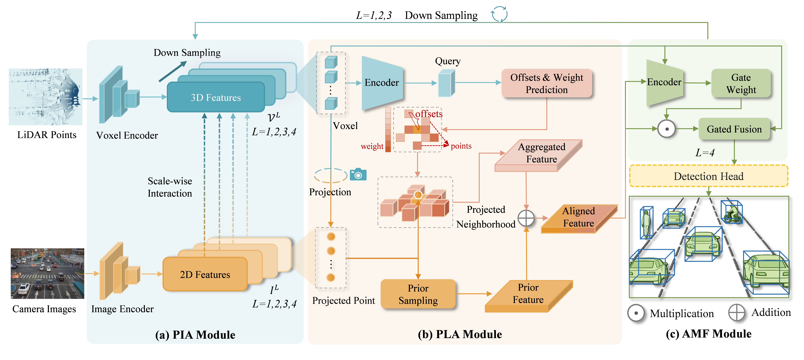
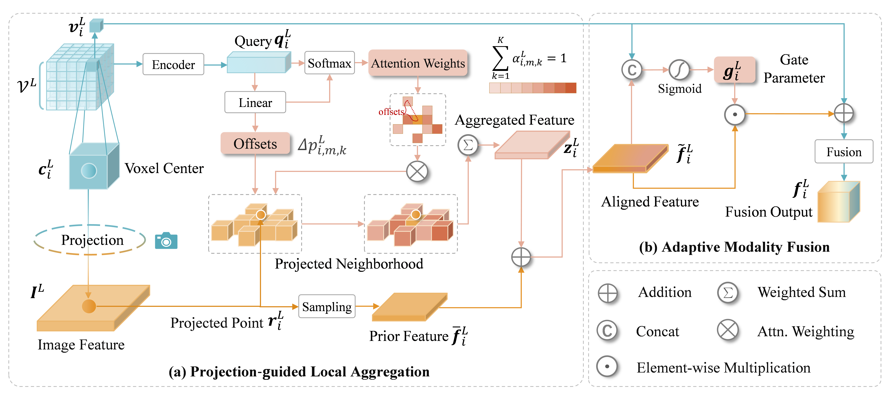
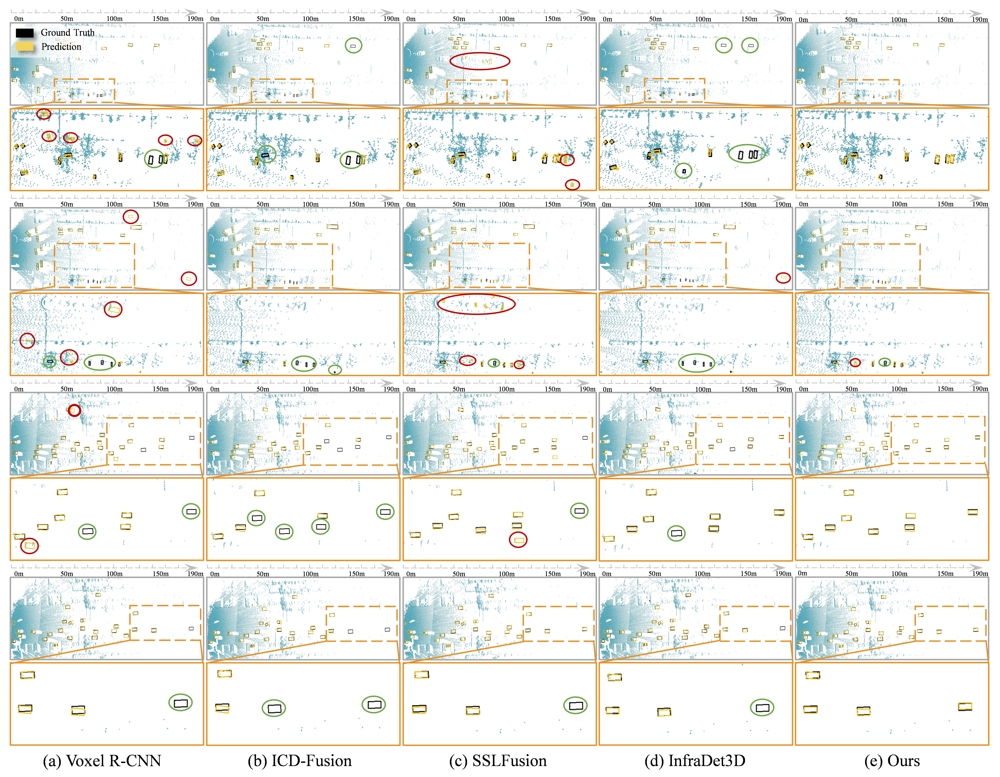
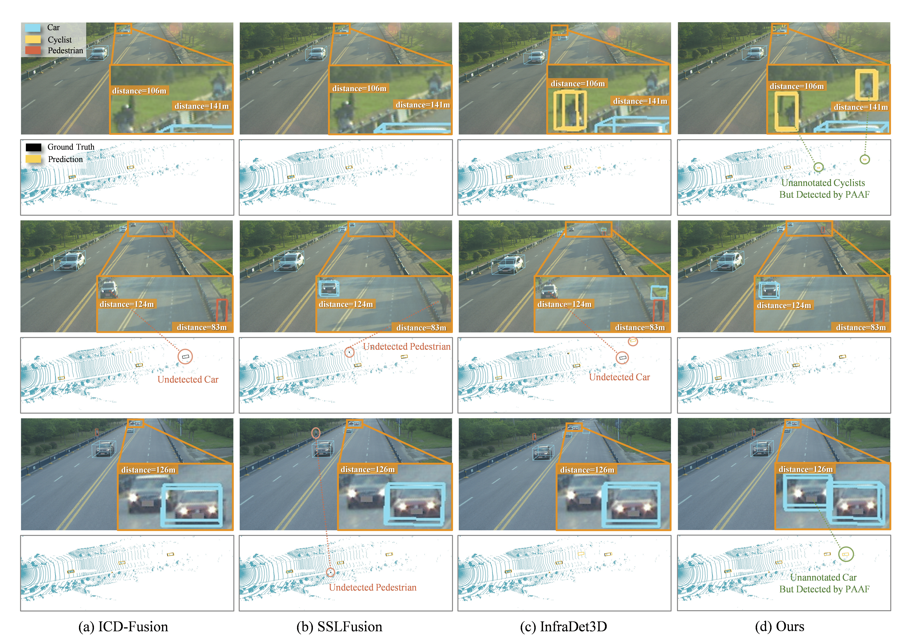

# 🚘 PAAF

PAAF is a camera-LiDAR 3D object detector for infrastructure-side perception. It is built on [OpenPCDet](https://github.com/open-mmlab/OpenPCDet).

The released training setting is the infrastructure split of [DAIR-V2X](https://github.com/AIR-THU/DAIR-V2X), stored in KITTI layout, with classes `Car`, `Pedestrian`, and `Cyclist`.

## 🔭 Overview

The detector fuses multi-scale LiDAR voxels and image features with three modules: projection-guided interaction (PIA), projection-guided local aggregation (PLA), and adaptive modality fusion (AMF).

<p align="center">
  
</p>

PLA samples a local image neighborhood around each voxel and aggregates it with learned offsets and attention weights. AMF then gates the aligned image feature into the LiDAR feature.

<p align="center">
  
</p>

Qualitative comparison on the bird's-eye view. Black boxes are ground truth and yellow boxes are predictions.

<p align="center">
  
</p>

Qualitative results on RCooper. Green notes mark objects found by PAAF that are missing from the annotation.

<p align="center">
  
</p>

## 🧩 Method

| Module | Implementation |
| --- | --- |
| Fusion | `pcdet/models/backbones_2d/fuser/paaf.py` |
| Sparse backbone | `pcdet/models/backbones_3d/paaf_backbone.py` |
| Detector | `pcdet/models/detectors/voxel_rcnn_multi_modal.py` |
| Image tower | frozen ResNet-50 + FPN |
| Config | `tools/cfgs/dair/paaf.yaml` |

## 🛠️ Installation

Tested with Python 3.8, PyTorch 2.0.1, CUDA 11.7, spconv 2.3.6, and mmcv-full 1.7.1. The versions in `requirements.txt` match that environment.

```bash
conda create -n paaf python=3.8 -y
conda activate paaf

pip install torch==2.0.1+cu117 torchvision==0.15.2+cu117 --extra-index-url https://download.pytorch.org/whl/cu117
pip install spconv-cu117==2.3.6
pip install mmcv-full==1.7.1 -f https://download.openmmlab.com/mmcv/dist/cu117/torch2.0/index.html
pip install -r requirements.txt

python setup.py develop
```

`python setup.py develop` compiles the CUDA ops (`iou3d_nms`, `roiaware_pool3d`, `roipoint_pool3d`, `pointnet2`). A C++/CUDA compiler and a matching CUDA toolkit are required.

Download the image-backbone weights:

```bash
mkdir -p checkpoints
wget -P checkpoints https://download.pytorch.org/models/resnet50-19c8e357.pth
```

## 📦 Data Preparation

### 1. Download DAIR-V2X

Download the infrastructure-side subset (`single-infrastructure-side`) and its official split file from [DAIR-V2X](https://github.com/AIR-THU/DAIR-V2X). The raw folders used by the converter are `image`, `velodyne`, `calib/camera_intrinsic`, `calib/virtuallidar_to_camera`, and the lidar labels.

### 2. Convert to KITTI format

Use the official converter in the DAIR-V2X repository. The default class merge maps `Bus`, `Van`, and `Truck` into `Car`. This codebase trains and evaluates `Car`, `Pedestrian`, and `Cyclist`.

```bash
# Run inside the DAIR-V2X repository.
python tools/dataset_converter/dair2kitti.py \
    --source-root /path/to/single-infrastructure-side \
    --target-root /path/to/PAAF/data/dair-kitti \
    --split-path data/split_datas/single-infrastructure-split-data.json \
    --label-type lidar \
    --sensor-view infrastructure
```

Place the converted dataset at `data/dair-kitti` inside this repository. The loader accepts `.jpg` or `.png` images and `float32` point clouds with four values `(x, y, z, intensity)`.

```
data/dair-kitti
├── ImageSets
│   ├── train.txt
│   └── val.txt
└── training
    ├── calib
    ├── image_2
    ├── label_2
    └── velodyne
```

Each `calib/*.txt` file must contain KITTI keys `P2`, `R0_rect`, and `Tr_velo_to_cam`. Each `label_2/*.txt` line follows the KITTI object format. Sample ids in `ImageSets` match the file stems, for example `000000`. The detector keeps points inside the camera field of view.

### 3. Generate info files and the GT database

From the repository root:

```bash
python -m pcdet.datasets.kitti.kitti_dataset create_kitti_infos \
    tools/cfgs/dataset_configs/dair_kitti_dataset.yaml
```

An optional third argument overrides the data directory. The default is `data/dair-kitti`. This writes:

- `dair_infos_train.pkl`, `dair_infos_val.pkl`, `dair_infos_trainval.pkl`
- `dair_dbinfos_train.pkl`
- `gt_database/`

Image GT-sampling reads the 2D boxes stored in these info files and pastes the corresponding image crops during training.

## 🚀 Training

All commands below are run from `tools/`, so the relative dataset path and ResNet weight path in the config resolve correctly.

Single GPU:

```bash
cd tools
python train.py --cfg_file cfgs/dair/paaf.yaml --batch_size 4 --workers 4
```

The default schedule is 60 epochs, Adam one-cycle with learning rate `0.0015`, a 2-epoch warmup, and gradient-norm clip `1`. Checkpoints and logs are saved to `output/dair/paaf/default/`.

Multiple GPUs:

```bash
cd tools
python -m torch.distributed.launch --nproc_per_node=4 train.py \
    --launcher pytorch \
    --tcp_port 18888 \
    --cfg_file cfgs/dair/paaf.yaml \
    --batch_size 16 \
    --workers 4
```

`--batch_size` is the total batch size and is split across GPUs. Override any config value without editing the yaml:

```bash
python train.py --cfg_file cfgs/dair/paaf.yaml --set OPTIMIZATION.NUM_EPOCHS 30
```

## 📈 Evaluation

```bash
cd tools
python test.py \
    --cfg_file cfgs/dair/paaf.yaml \
    --ckpt ../output/dair/paaf/default/ckpt/checkpoint_epoch_60.pth \
    --batch_size 4
```

The metric is the KITTI AP protocol on the validation split (`ImageSets/val.txt`), reported at the standard difficulties for `Car`, `Pedestrian`, and `Cyclist`. Add `--save_to_file` to write the prediction txt files under the experiment directory.

## 🙏 Acknowledgements

This repository is built on [OpenPCDet](https://github.com/open-mmlab/OpenPCDet) and uses [spconv](https://github.com/traveller59/spconv), [MMCV](https://github.com/open-mmlab/mmcv), and the [DAIR-V2X](https://github.com/AIR-THU/DAIR-V2X) dataset. Please also cite those projects when you use this code.

## 📝 Citation

```bibtex
@misc{paaf2026,
  title = {PAAF},
  howpublished = {\url{https://github.com/cugzrl/PAAF}},
  year = {2026}
}
```

## 📄 License

The codebase is released under the Apache License 2.0. See [LICENSE](LICENSE). It includes code from OpenPCDet, which is also Apache 2.0.
